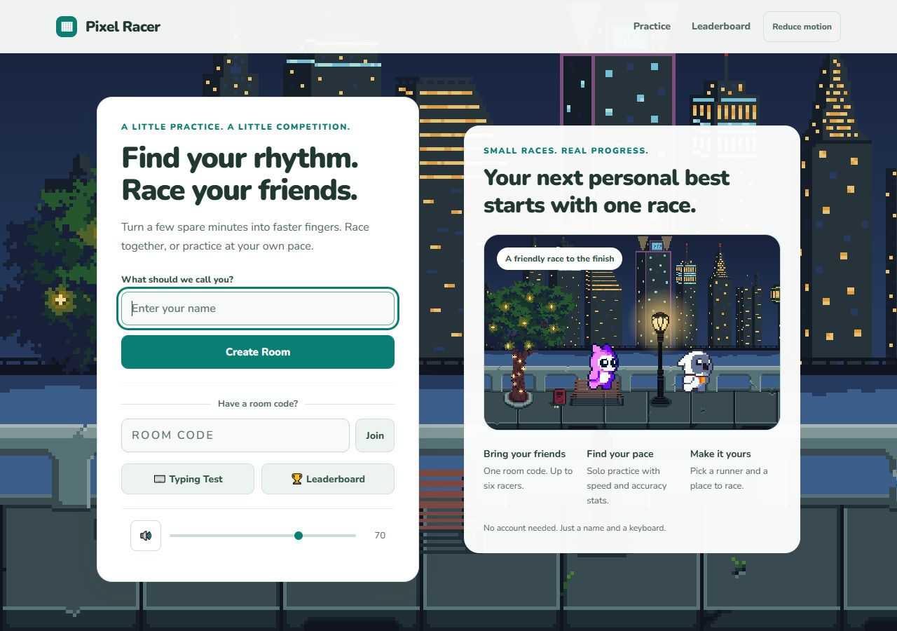

# Pixel Racer

A browser-based typing game with real-time multiplayer races, animated pixel art runners, and optional AI-generated passages and coaching.

Built with vanilla JavaScript, Node.js, Express, and Socket.IO.



[Desktop race](docs/screenshots/desktop-race.jpg) · [Phone lobby](docs/screenshots/mobile.jpg) · [Phone race](docs/screenshots/mobile-race.jpg)

[Neon Street with a Pixel Adventure runner](docs/screenshots/neon-street-race.jpg)

[SunnyLand race](docs/screenshots/sunnyland-race.jpg) · [Magic Cliffs race](docs/screenshots/magic-cliffs-race.jpg)

[Woodland with the Fox runner](docs/screenshots/woodland-fox-race.jpg)

## Features

- Multiplayer rooms for up to six players, with shareable room codes.
- Automatic recovery from brief connection drops, with a connection status overlay and manual retry.
- Simulated opponents when a player races alone in multiplayer mode.
- Give Up and Leave Match controls, with a visible 30-second finish window after the first racer finishes (including bots).
- Solo typing tests with WPM, accuracy, word timings, and performance charts.
- Pixel art characters, selectable parallax backgrounds, and synthesized sound effects.
- Neon Street scenery and four Pixel Adventure runners; all are available in solo practice, with Ninja Frog and Neon Street also free in multiplayer.
- SunnyLand forest and Magic Cliffs scenery, with scrolling grass platforms; both backgrounds are free in solo and multiplayer.
- Woodland scenery and Fox/Squirrel runners, available for coins in multiplayer and free to try in solo practice.
- Paid cosmetics cost 900–2,100 coins, with existing purchases preserved. Race rewards and power-up prices remain the same.
- Full-screen scenery with runners anchored along the bottom; the typing card scrolls independently on smaller screens.
- Coins, race modifiers, and multiplayer Zap and Shield power-ups.
- A local top-ten leaderboard backed by a JSON file.
- Optional Groq integration for generated passages and post-race coaching.
- Responsive layouts with scrollable setup/results screens and touch-friendly race controls.
- Keyboard-accessible controls, visible focus, labelled inputs, announced current words and typing errors, and accessible chart summaries.
- Reduced motion respects the operating system preference and can also be enabled in the header.

## Run locally

Use Node.js 22.23.4 or later within major 22 and npm; .node-version pins 22.23.4, also used by CI and local security verification.

```sh
npm ci
```

Copy `.env.example` to `.env`:

```powershell
# Windows PowerShell
Copy-Item .env.example .env
```

```sh
# macOS / Linux
cp .env.example .env
```

Then start the server:

```sh
npm start
```

Open [localhost:3000](http://localhost:3000). For a multiplayer demo, open the game in two browser tabs, enter different names, create a room in the first tab, and join using its code in the second. Ready up in both tabs to race.

The game runs without an AI key using its built-in quote library and a general practice tip. Personalized AI coaching requires a key.

## Optional AI setup

Create a key in the [Groq console](https://console.groq.com), then configure `.env`:

```dotenv
GROQ_API_KEY=your_key_here
GROQ_MODEL=openai/gpt-oss-20b
```

Both passage generation and coaching use this model. Groq offers a free plan with usage limits; check the [current limits](https://console.groq.com/docs/rate-limits) and your account's model permissions. The API key stays on the server and `.env` is excluded from version control.

Passages are prepared before the three-second countdown. AI calls time out after five seconds without automatic retries; unavailable passage generation falls back to the built-in library.

Smart quotes, dashes, and unusual spaces are normalized for keyboard typing. Apostrophes can be entered using a straight apostrophe or backtick. A race has a five-minute hard limit (plus 30 seconds with Extra Time); the first finisher starts a 30-second window without extending that limit. Giving up marks the player DNF and awards no coins. Incomplete racers never enter the leaderboard. If all human players have finished or given up when someone gives up, results appear immediately.

## Configuration

| Variable | Default | Purpose |
| --- | --- | --- |
| `PORT` | `3000` | HTTP and Socket.IO server port |
| `NODE_ENV` | `development` | Set to `production` when deploying |
| `ALLOWED_ORIGIN` | `http://localhost:<PORT>` in development | Exact public HTTPS origin required in production |
| `TRUSTED_PROXIES` | Empty | Explicit proxy IPs/CIDRs allowed to supply client IP headers |
| `GROQ_API_KEY` | Empty | Enables optional AI features |
| `GROQ_MODEL` | `openai/gpt-oss-20b` | Model for passages and coaching |

## How it works

Express serves the game and its REST endpoints. Socket.IO manages room membership, ready states, countdowns, race updates, and power-up events. The server selects a single passage for the room and begins race timing only after preparation and the countdown complete.

The browser handles typing input, animation, audio, and performance charts. Preferences and coins are stored in local storage; recent race history uses session storage. Leaderboard results are stored in `server/leaderboard.json`, which is generated at runtime and excluded from version control.

Leaving a match or switching rooms removes the previous membership immediately, clears its modifiers/rematch votes, and transfers host ownership when needed. Empty rooms and their timers are cleaned up. Temporary network drops hold the player's spot for 20 seconds using Socket.IO connection state recovery; the same browser session can recover its identity, progress, and missed events. Typing is disabled while disconnected and the race clock continues. If recovery expires or the server restarts, the player returns to the lobby with an explanation. Reloading the page starts a new browser connection; recovery applies to network interruptions in the existing page.

```text
public/
  index.html          Game screens and legacy inline styles
  game.js             Client logic and cosmetic configuration
  ui-events.js        Static event listeners for game controls
  ui.css              Responsive presentation and motion styles
  ui-accessibility.js Screen focus, control labels, and motion preferences
  typing-text.js      Shared punctuation normalization
  assets/             Pixel art backgrounds and sprite sheets
server/
  index.js            Express routes and Socket.IO game server
  race-rules.js       Finish window and give-up rules
  security.js         Validation, bounded rate limits, and origin checks
tests/
  *.test.js           Race, typing, room cleanup, and connection recovery tests
.env.example          Configuration template without secrets
SECURITY.md           Existing security notes and deployment checklist
```

## Development and checks

```sh
npm test
node --check server/index.js
```

`npm run dev` starts the server through `npx nodemon`; its first run may prompt npm to download nodemon.

## Deployment and current limitations

Use a Node.js host that supports persistent WebSocket connections. Set `NODE_ENV=production`, set `ALLOWED_ORIGIN` to your public origin, and configure secrets through the host's environment settings. Use HTTPS in production.

Production refuses to start without an exact HTTPS `ALLOWED_ORIGIN` (no path or trailing slash). If running behind a proxy, configure only its IPs/CIDRs in `TRUSTED_PROXIES` and block direct public access to Node. See [security controls and deployment requirements](SECURITY.md). The game runs with a same-origin script policy; executable code and control event listeners live in external JavaScript files.

- Rooms live in memory and are lost when the server restarts. The current design uses one server instance.
- Leaderboard data needs a persistent writable disk to survive redeployments.
- Scores and coins currently depend on client-reported data, so the leaderboard is intended for casual play rather than verified competition.
- Google Fonts requires an internet connection; system fonts provide a fallback.
- Responsive layouts were checked at 320px and 390px phone widths, desktop size, and short landscape size. Real-device virtual keyboards and a full screen-reader audit remain to be tested.
- Original and newly added artwork sources and licenses are documented in [asset credits](ASSET_CREDITS.md), with [verification evidence](docs/artwork-license-audit.md) for the original backgrounds and monsters. Keep the artwork credits and license notices when distributing the game. A public demo remains to be added before a portfolio release.
